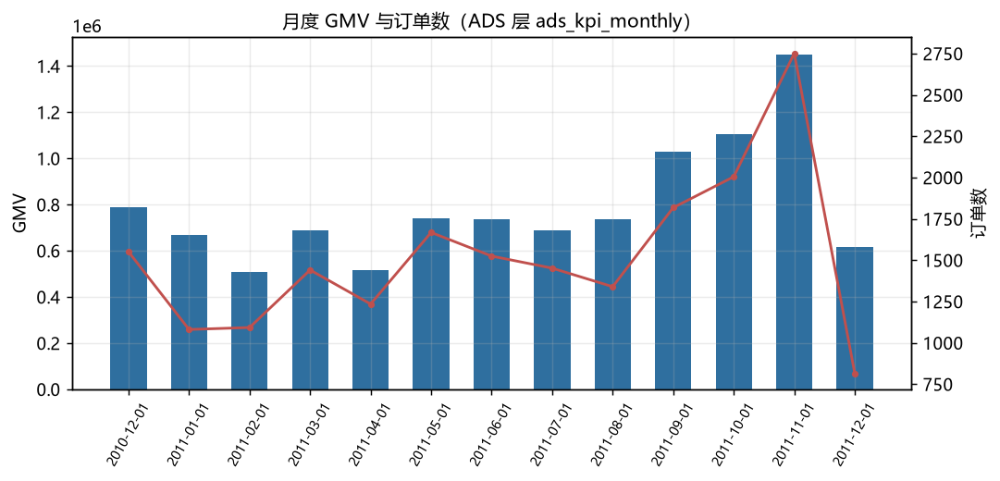

# 离线数仓：电商交易数据的四层建模

把一份原始交易数据加工成 **ODS → DWD → DWS → ADS** 四层，让每个业务指标都有自己的出处。



## 这份项目要证明什么

不是「我会写 SQL」，而是**我知道一个指标该在哪一层、按什么粒度、用什么口径算出来**。

数据：UCI Online Retail（英国电商，约 54 万条交易，2010–2011）。

## 四层结构

| 层 | 表 | 内容 |
| --- | --- | --- |
| ODS | `ods_retail` | 原始数据原样落地，不清洗 |
| DWD | `dwd_order_detail` + `dim_customer` / `dim_product` / `dim_date` | 清洗后的明细事实表 + 三个维度表 |
| DWS | `dws_customer` / `dws_product_daily` | 客户、商品两个主题的预聚合 |
| ADS | `ads_kpi_monthly` / `ads_kpi_summary` / `ads_country_rank` | 面向业务的指标宽表 |

## 关键设计

**清洗只做在 DWD**，四个条件各有理由：

```sql
quantity > 0        -- 退货单在原始数据里是负数
unit_price > 0      -- 赠品、内部调拨、价格缺失
customer_id 非空    -- 匿名订单无法归属客户
invoice_no 非空     -- 订单号是事实表的粒度键
```

**指标只在 ADS 定义一次**：

```sql
复购率 = 下单次数 ≥ 2 的客户数 / 有客户 ID 的客户数
客单价 = GMV / 订单数（订单按 invoice_no 去重）
```

## 运行

```bash
python src/run.py
```

首次运行会把 Excel 转成 parquet（较慢），之后走缓存。结果在 `reports/`，数据库在 `warehouse.duckdb`。

## 结构

```
A-offline-warehouse/
├── src/run.py            主流程
├── sql/01_ods.sql        原始落地
├── sql/02_dwd.sql        清洗 + 维度建模   ★
├── sql/03_dws.sql        主题汇总
├── sql/04_ads.sql        指标口径         ★
└── reports/              findings.md / metrics.json / figs
```

## 技术选择

本地用 **DuckDB** 跑，SQL 语法与 Hive / Spark SQL 基本一致（`DATE_TRUNC`、`EXTRACT`、窗口函数通用）。把 `CREATE TABLE` 换成 Hive 的建表语句、数据源换成 HDFS 路径，就是集群上的版本。

## 数据

UCI Machine Learning Repository — Online Retail Data Set。

## 学这个项目

见 [LEARNING.md](LEARNING.md)。
