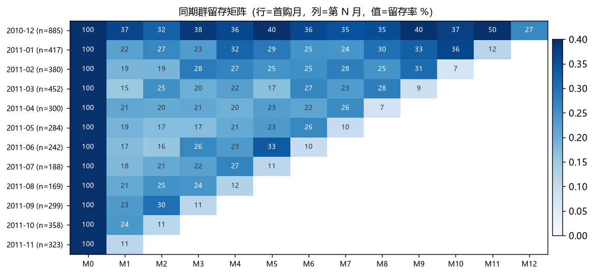

# 电商用户留存与复购分析

用纯 SQL 回答三个运营每天都在问的问题：**拉来的客户还回来吗、多久回来一次、谁要走了**。



## 三个分析

**1. Cohort 留存矩阵**
按首购月份把客户分组，看第 N 个月还有多少人回来。行是同期群，列是月份，格子里的数字是留存率。

**2. 复购间隔**
用窗口函数 `LAG` 取同一客户的上一个订单时间，得到相邻两次下单的间隔，看复购周期的分布。

**3. RFM 分层 + 流失预警**
- R = 最近一次购买距今多少天
- F = 下单次数
- M = 累计金额

三个维度各用 `NTILE(5)` 切 5 档，组合成「重要价值 / 重要挽留 / 新客户 / 沉睡 / 已流失」等分层，并输出「买过 2 次以上、已 90 天未回」的预警名单。

## 关键 SQL

```sql
-- 复购间隔
LAG(order_time) OVER (PARTITION BY customer_id ORDER BY order_time)

-- RFM 打分（R 要降序，最近买的得高分）
NTILE(5) OVER (ORDER BY recency_days DESC) AS r_score

-- 占比：不分组算总量
COUNT(*)::DOUBLE / SUM(COUNT(*)) OVER ()
```

## 结果

| 指标 | 数值 |
| --- | --- |
| 客户数 | 4,338 |
| 复购客户（≥2 单） | 2,845，复购率 **65.6%** |
| 次月留存 M1 | **22.7%** |
| 复购间隔中位数 / 均值 | **22 天** / 40 天 |
| 流失预警（≥2 单且 90 天未回） | **602 人**，涉及历史 GMV 678,132 |

**RFM 分层**（这一层的数据结构就是汇报 PPT 的第一页）：

| 分层 | 人数占比 | GMV 占比 |
| --- | --- | --- |
| 重要价值 | 27.2% | **66.6%** |
| 一般保持 | 26.9% | 15.3% |
| 已流失 | 26.1% | 5.9% |
| 沉睡 | 9.0% | 4.8% |
| 重要挽留 | 4.9% | 4.4% |
| 新客户 | 5.8% | 2.9% |

一句话：**27% 的人贡献了 67% 的 GMV**，运营资源该往哪里倾斜一目了然。

跑完看 `reports/findings.md`；`cohort_retention.csv` 和 `rfm_summary.csv` 可以直接拖进 Excel。

## 运行

```bash
python src/run.py
```

数据：把 `*.xlsx` 放到 `data/raw/` 下；或者先跑 `../A-offline-warehouse`，这里会复用它的 parquet 缓存。

## 结构

```
B-retention-analysis/
├── src/run.py                   执行 SQL、画图、生成报告
├── sql/01_clean.sql             清洗
├── sql/02_cohort.sql            留存矩阵        ★
├── sql/03_rfm.sql               RFM 分层
├── sql/04_interval_churn.sql    复购间隔 + 流失名单
└── reports/
```

## 学这个项目

见 [LEARNING.md](LEARNING.md)。重点看「留存率 vs 复购率」的区别——面试很容易在这问倒人。
