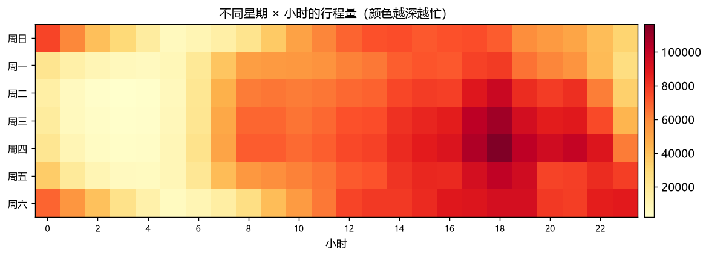

# 纽约黄色出租车行程分析（SQL）

950 万条真实行程，用 SQL 回答「什么时候最忙、钱怎么付、数据有多脏」。



## 结果

| 指标 | 数值 |
| --- | --- |
| 原始行数 | 9,554,778 |
| 清洗后保留 | 9,199,099（96.3%） |
| 平均行程时长 | 15.6 分钟 |
| 平均里程 | 3.30 英里 |
| 平均速度 | 11.3 英里/小时 |
| 最忙时段 | 18 点 |
| 最忙上车区域 | Zone 161 |
| 日均行程 | 约 10.1 万单 |
| 信用卡支付占比 | 78.1%，小费率 22.6% |

**数据质量**（这是本项目最值钱的部分）：里程 ≤0 有 215,764 行、金额 ≤0 有 117,187 行、时间倒挂 2,801 行，还有 252 行里程超过 100 英里（最大 312,722 英里）——这 252 行合计 783 万英里，会把平均里程从 3.30 拉到 4.15。不做体检直接算均价，结果一定是错的。

## 一个容易被忽略的口径陷阱

现金支付（payment_type=2）的小费率是 **0%**。看起来像「现金客户不给小费」，实际上是**记录不到**——现金小费不会进计价器。

所以在比较小费率时，必须只限定信用卡客户，这属于典型的指标口径问题。

## 运行

```bash
python src/run.py
```

数据会自动读到 `data/` 下的 parquet（默认 2024 年 1–3 月）。

## 结构

```
C-taxi-sql/
├── src/run.py                 执行 SQL → 算指标 → 出 4 张图 → 写报告
├── sql/01_quality.sql         数据质量体检
├── sql/02_analysis.sql        清洗 + 四个主题汇总
└── reports/
    ├── findings.md            自动生成
    ├── metrics.json
    └── figs/                  热力图 / 支付占比 / 区域排行 / 日趋势
```

## 技术选择

950 万行用 Excel 打不开（上限 104 万行），用 pandas 每次聚合都要全量读内存。这里用 **DuckDB**：列式存储、直接查 parquet、标准 SQL，几秒出结果。

工具要和数据量匹配——这个体量上 Spark 的启动开销比计算本身还大。

## 数据来源

NYC TLC Trip Record Data（yellow taxi，2024 年 1–3 月）。
下载地址：`https://d37ci6vzurychx.cloudfront.net/trip-data/yellow_tripdata_2024-01.parquet`（改月份即可）。

## 学这个项目

见 [LEARNING.md](LEARNING.md)：5 个核心概念、3 步上手、5 个练习、10 道自测题、面试追问。

